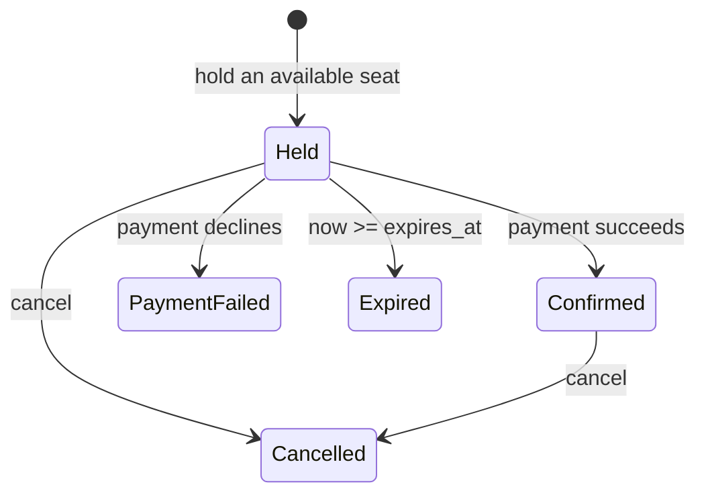
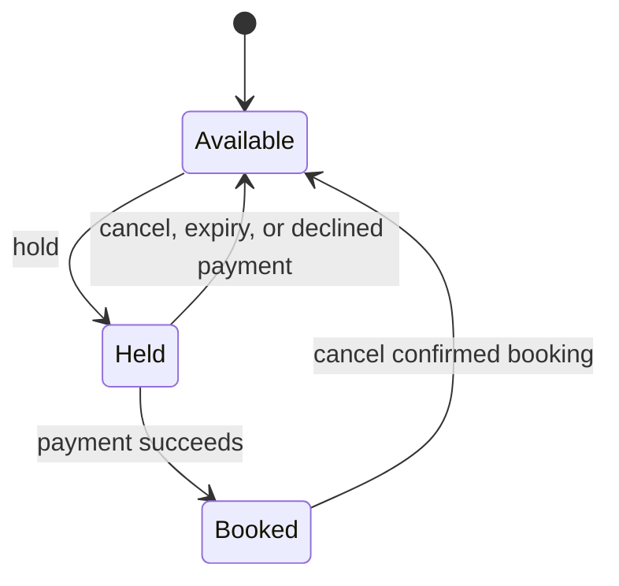

# Booking model

This file is the behavioral contract for the backend. It is not the course report.

## Assumptions

- There is no authentication. The passenger name and email are supplied by the caller.
- Email comparison is case-insensitive. Stored emails are trimmed and lowercased.
- Names are trimmed, internal whitespace is collapsed, and the limit is 80 characters.
- One passenger may have only one active reservation per flight. Active means `confirmed`, or `held` while `now < expires_at`.
- The same passenger may hold or confirm seats on different flights.
- A hold lasts 15 minutes unless `create_app(hold_minutes=...)` changes it. The duration must be positive.
- A hold is expired when `expires_at` is missing or `now >= expires_at`.
- Expiry is lazy. Seat lists, booking reads, holds, confirms, cancels, and `POST /maintenance/expire-holds` run it. There is no background thread.
- Invalid passenger input and a blank payment token do not expire holds.
- Prices are copied onto the booking at hold time and are stored in cents.
- A non-positive price fails payment with reason `invalid_amount` and releases the seat.
- Payment is simulated. Tokens `fail`, `declined`, and `insufficient_funds` decline. Comparison ignores case. Any other non-empty token succeeds. Nothing is charged externally.
- A declined payment keeps the booking as `payment_failed`. Confirming it again is rejected. The passenger must create a new hold.
- Cancelling a `payment_failed` or `expired` booking is rejected. The seat was already released.
- When a passenger already has an active reservation, a new hold returns `duplicate_reservation` even if the seat is also unavailable.
- Seat release changes a seat only when `seat.booking_id` is still this booking. A seat owned by another booking is left alone.
- All timestamps are timezone-aware UTC.
- The in-memory store is the reference behavior. PostgreSQL must match it.

## Booking states

`expired`, `cancelled`, and `payment_failed` do not transition further.

## Seat states

## API

| Method | Path | Success | Failure codes |
| --- | --- | --- | --- |
| GET | `/health` | 200 | |
| GET | `/flights` | 200 | |
| GET | `/flights/{flight_id}` | 200 | 404 `flight_not_found` |
| GET | `/flights/{flight_id}/seats?status=` | 200 | 404 `flight_not_found`, 422 bad status |
| POST | `/bookings/holds` | 201 booking | 400/422 invalid input, 404 flight or seat, 409 `seat_unavailable` or `duplicate_reservation` |
| POST | `/bookings/{id}/confirm` | 200 booking | 402 `payment_failed`, 409 `hold_expired` or `invalid_transition`, 404 |
| POST | `/bookings/{id}/cancel` | 200 booking | 409 `hold_expired` or `invalid_transition`, 404 |
| GET | `/bookings/{id}` | 200 booking | 404 `booking_not_found` |
| POST | `/maintenance/expire-holds` | 200 `{"expired": n}` | |

Error JSON is `{"error": "<code>", "detail": "<message>"}`. Payment and hold-expiry errors also include `booking_id`.

Stable seed ids:

- `flt-100` / `AC101` / YYZ-YVR, seats `flt-100-1A`, `flt-100-1B`, `flt-100-1C`
- `flt-200` / `AC202` / YYZ-YUL, seats `flt-200-1A`, `flt-200-1B`

## Where teammates attach work

- Graph and logic coverage: `app/domain/rules.py` and `app/services/booking_service.py`.
- Defect injection: replace `SimulatedPaymentGateway` or pass another `PaymentGateway` into `create_app`.
- PostgreSQL: implement `BookingStore` in `app/repositories/base.py`, then pass it to `create_app(store=...)`. Schema: `docs/postgres.sql`.
- Concurrency: `tests/test_concurrency.py` shows the outcomes the store must preserve.
- ISP characteristics worth partitioning: flight id, seat id, seat status, passenger email, passenger name, payment token, booking status, and the expiry boundary `now < expires_at` versus `now >= expires_at`.
