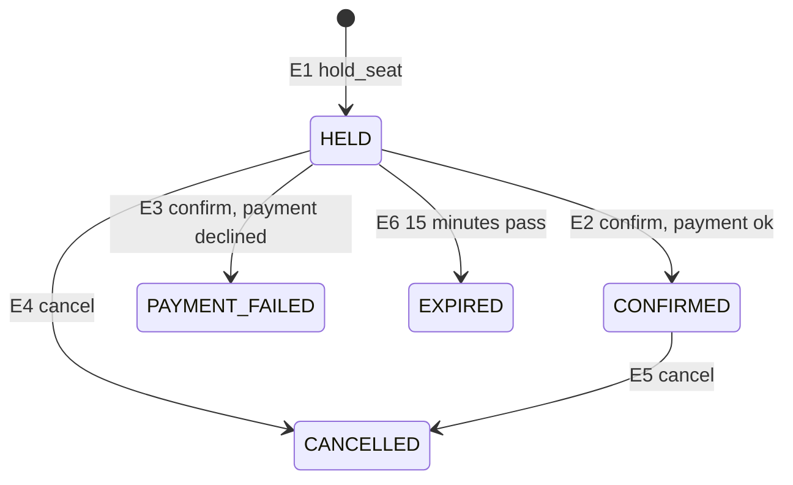

# Graph coverage

This note models the booking lifecycle as a state graph and maps each edge to a
pytest test in `tests/test_graph_coverage.py`. The interface under test is
`BookingService` (`app/services/booking_service.py`).

## Booking lifecycle graph

- Nodes: START, HELD, CONFIRMED, PAYMENT_FAILED, CANCELLED, EXPIRED
- Initial node: START
- Final nodes: CONFIRMED, PAYMENT_FAILED, CANCELLED, EXPIRED

## Edges

| Edge | From → To | What causes it | Code (`booking_service.py`) |
| --- | --- | --- | --- |
| E1 | START → HELD | `hold_seat` on a free seat | `hold_seat`, `status=BookingStatus.HELD` |
| E2 | HELD → CONFIRMED | `confirm_booking` with a working token (`ok`) | `confirm_booking`, `status=BookingStatus.CONFIRMED` |
| E3 | HELD → PAYMENT_FAILED | `confirm_booking` with a decline token (`fail`) | `confirm_booking`, `status=BookingStatus.PAYMENT_FAILED` |
| E4 | HELD → CANCELLED | `cancel_booking` before paying | `cancel_booking`, `status=BookingStatus.CANCELLED` |
| E5 | CONFIRMED → CANCELLED | `cancel_booking` after paying | `cancel_booking`, `status=BookingStatus.CANCELLED` |
| E6 | HELD → EXPIRED | any service call once the 15-minute deadline is reached | `_expire_elapsed`, `status=BookingStatus.EXPIRED` |

## Edge coverage

Every edge is travelled by at least one test. Each test checks both the
booking status and the seat status after the transition.

| Edge | Test | Booking after | Seat after |
| --- | --- | --- | --- |
| E1 | `test_E1_hold_creates_held_booking` | HELD | HELD |
| E2 | `test_E2_payment_ok_confirms_booking` | CONFIRMED | BOOKED |
| E3 | `test_E3_payment_declined_frees_seat` | PAYMENT_FAILED | AVAILABLE |
| E4 | `test_E4_cancel_held_booking_frees_seat` | CANCELLED | AVAILABLE |
| E5 | `test_E5_cancel_confirmed_booking_frees_seat` | CANCELLED | AVAILABLE |
| E6 | `test_E6_hold_expires_after_15_minutes` | EXPIRED | AVAILABLE |

## Notes

- Nothing expires on a timer; a held booking becomes EXPIRED
  the next time any service method runs after `expires_at`. E6 therefore
  advances the fake clock and then calls `get_booking` to trigger it.
- A hold is expired when `now == expires_at` (the rule is `expires_at > now`),
  so E6 advances exactly 15 minutes.
- Payment is simulated. The tokens `fail`, `declined` and `insufficient_funds`
  are declined; any other non-empty token succeeds.

## Illegal transitions

Edges that must not exist. For every state, both actions that move a booking
(`confirm_booking` and `cancel_booking`) were tried. Seven combinations must be
rejected. Each test reaches the state, attempts the action, expects the error,
and then checks that neither the booking nor the seat changed.

| From state | `confirm_booking` | `cancel_booking` |
| --- | --- | --- |
| CONFIRMED | `InvalidTransition`: `test_illegal_confirm_confirmed_booking` | allowed (E5) |
| CANCELLED | `InvalidTransition`: `test_illegal_confirm_cancelled_booking` | `InvalidTransition`: `test_illegal_cancel_cancelled_booking` |
| PAYMENT_FAILED | `InvalidTransition`: `test_illegal_confirm_payment_failed_booking` | `InvalidTransition`: `test_illegal_cancel_payment_failed_booking` |
| EXPIRED | `HoldExpired`: `test_illegal_confirm_expired_booking` | `HoldExpired`: `test_illegal_cancel_expired_booking` |
